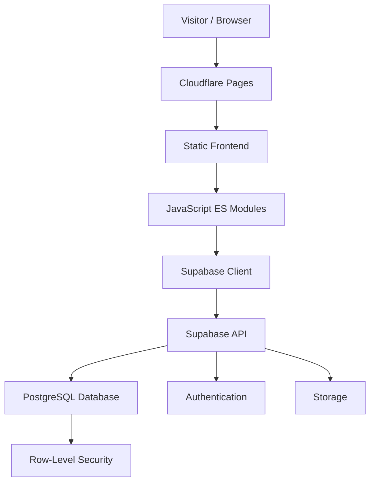
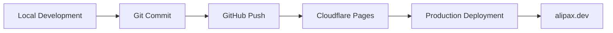

 <div align="center">


<br/>

### Building meaningful digital experiences through technology.

<p>
  <a href="https://alipax.dev">
    
  </a>
  <a href="https://github.com/alipax-dev">
    
  </a>
</p>

<p>
  
  
  
  
</p>

</div>

---

## Overview

**Alipax** is a digital platform built around modern web technologies, software engineering principles, and a serverless architecture.

The project aims to deliver a responsive, maintainable, and efficient web experience through a modular frontend, managed backend services, and globally distributed hosting infrastructure.

The architecture separates the public website from backend services, allowing each component to evolve independently.

### Project objectives

- Deliver a modern and responsive digital experience.
- Maintain a modular and understandable codebase.
- Use managed backend services and database infrastructure.
- Apply security-conscious development practices.
- Optimize performance, accessibility, and search engine visibility.
- Support a maintainable and scalable development workflow.

---

## Table of Contents

- [Architecture](#architecture)
- [Technology Stack](#technology-stack)
- [Project Structure](#project-structure)
- [Getting Started](#getting-started)
- [Environment Configuration](#environment-configuration)
- [Database Setup](#database-setup)
- [Deployment](#deployment)
- [Security](#security)
- [SEO and Performance](#seo-and-performance)
- [Development Guidelines](#development-guidelines)
- [Contributing](#contributing)
- [Project Links](#project-links)

---

## Architecture

Alipax follows a **Jamstack / Serverless architecture**.

The frontend is deployed through Cloudflare Pages, while Supabase provides database, authentication, storage, and access-control services.



### Architecture components

| Component | Responsibility |
|:--|:--|
| Cloudflare Pages | Frontend hosting and global content delivery |
| HTML / CSS / JavaScript | User interface and client-side functionality |
| JavaScript ES Modules | Modular frontend application structure |
| Supabase | Backend-as-a-Service infrastructure |
| PostgreSQL | Relational database |
| Supabase Auth | Authentication services |
| Supabase Storage | File storage |
| Row-Level Security | Database-level access control |

---

## Technology Stack

### Frontend

<p>
  
</p>

- **HTML5** — Semantic page structure and accessible markup.
- **CSS3** — Modular styling and responsive layouts.
- **JavaScript** — Client-side application logic.
- **ES Modules** — Modular and reusable JavaScript components.

### Backend and Database

<p>
  
</p>

- **Supabase** — Backend services.
- **PostgreSQL** — Relational data management.
- **Supabase Auth** — User authentication.
- **Supabase Storage** — File management.
- **RLS** — Fine-grained database access policies.

### Infrastructure and Development

<p>
  
</p>

- **Cloudflare Pages** — Deployment and CDN.
- **Git** — Version control.
- **GitHub** — Source code collaboration.
- **Supabase CLI** — Database migrations and project management.

---

## Project Structure

```text
alipax-website/
│
├── .env.example
│
├── docs/
│   └── Technical documentation
│
├── frontend/
│   │
│   ├── index.html
│   ├── _redirects
│   ├── _headers
│   ├── robots.txt
│   ├── sitemap.xml
│   ├── manifest.json
│   │
│   ├── pages/
│   │   ├── detail-projet.html
│   │   ├── equipe.html
│   │   ├── faq.html
│   │   ├── lecture-article.html
│   │   ├── maintenance.html
│   │   ├── mentions-legales.html
│   │   ├── nos-services.html
│   │   ├── politique-confidentialite.html
│   │   ├── portfolio.html
│   │   ├── projets.html
│   │   ├── suivi-commande.html
│   │   ├── tarification.html
│   │   ├── technologies.html
│   │   └── temoignages.html
│   │
│   ├── admin/
│   │   └── Administration interface
│   │
│   └── assets/
│       ├── css/
│       ├── js/
│       │   └── config/
│       │       └── env.js
│       ├── images/
│       ├── fonts/
│       └── other resources
│
└── supabase/
    ├── config.toml
    ├── migrations/
    │   └── 20261115000000_schema_initial.sql
    └── seed.sql
```

> The project structure may evolve as new features and modules are introduced.

---

## Getting Started

Follow these instructions to obtain a local copy of the project and prepare your development environment.

### Prerequisites

Make sure the following tools are available:

| Tool | Purpose |
|:--|:--|
| Git | Source code management |
| Node.js and npm | Supabase CLI execution |
| Supabase account | Database and backend services |
| Code editor | Development environment |

### 1. Clone the repository

```bash
git clone https://github.com/alipax-dev/alipax-website.git

cd alipax-website
```

### 2. Configure Supabase

Create or select a Supabase project.

Retrieve the project's public connection information:

- Project URL
- Publishable key, or legacy anon key

Configure these values in:

```text
frontend/assets/js/config/env.js
```

Use the configuration format expected by the existing Supabase client in the project.

### 3. Run the frontend locally

Serve the `frontend/` directory using a local HTTP development server.

For example, with Python installed:

```bash
python -m http.server 8000 --directory frontend
```

Open:

```text
http://localhost:8000
```

Using an HTTP server is recommended because the application uses JavaScript ES Modules.

---

## Environment Configuration

The `.env.example` file provides a reference for environment variables used by the project and its tooling.

Before development, review the configuration files and replace placeholder values with the appropriate project settings.

### Important security considerations

- Never commit private credentials or production secrets.
- Never expose Supabase `service_role` or secret API keys in frontend JavaScript.
- Only publish credentials explicitly designed for browser-side use.
- Keep private backend credentials in an appropriate secure environment.

---

## Database Setup

Alipax uses Supabase and PostgreSQL for backend data management.

Database migrations are maintained in:

```text
supabase/migrations/
```

Seed data is maintained in:

```text
supabase/seed.sql
```

### 1. Install and authenticate the Supabase CLI

```bash
npx supabase login
```

### 2. Link the local project

Replace the placeholder with your actual Supabase project reference:

```bash
npx supabase link --project-ref YOUR_PROJECT_REF
```

### 3. Apply database migrations

```bash
npx supabase db push
```

This applies the pending migrations to the linked Supabase database.

> Review migrations before applying them to a production database. The seed file is maintained separately and should be applied according to the project's database workflow.

---

## Deployment

The frontend is designed to be deployed using **Cloudflare Pages**.

### Cloudflare Pages configuration

| Setting | Value |
|:--|:--|
| Production branch | `main` |
| Framework preset | None |
| Root directory | `/` |
| Build command | Leave empty |
| Build output directory | `frontend` |

Since the frontend consists of static HTML, CSS, and JavaScript files, a build command is not required by the current architecture.

### Deployment workflow



Once Git integration is configured, changes pushed to the production branch can trigger automatic deployments.

### Production domain

The official website domain is:

**https://alipax.dev**

The custom domain must be configured in the Cloudflare Pages project's domain settings.

---

## Security

Security is an essential part of the project's development approach.

The repository includes:

- `_headers` for HTTP response header configuration.
- Supabase Row-Level Security policies.
- Managed authentication services.
- Environment configuration references.
- Separation between public frontend configuration and private credentials.

### Security checklist

- [ ] Review Supabase RLS policies.
- [ ] Protect privileged API credentials.
- [ ] Validate user input on trusted backend boundaries.
- [ ] Review HTTP security headers.
- [ ] Verify authentication and authorization flows.
- [ ] Avoid committing secrets to Git.

---

## SEO and Performance

The frontend includes resources intended to support discoverability and browser integration.

| Resource | Purpose |
|:--|:--|
| `robots.txt` | Search engine crawling instructions |
| `sitemap.xml` | Website URL discovery |
| `manifest.json` | Web application metadata |
| `_redirects` | URL routing and rewrite rules |
| `_headers` | HTTP response and caching policies |

The project aims to maintain a responsive experience, predictable URL structure, and efficient delivery of static assets.

---

## Development Guidelines

To maintain consistency across the codebase:

1. Prefer semantic and accessible HTML.
2. Keep CSS organized into reusable modules.
3. Use JavaScript ES Modules for modular application logic.
4. Keep frontend configuration separate from application functionality.
5. Use descriptive names for files, functions, and variables.
6. Review database migrations before deployment.
7. Avoid unnecessary dependencies.
8. Test important user flows before production releases.

---

## Contributing

Contributions and improvements are welcome.

To propose a change:

1. Fork or obtain access to the repository.
2. Create a dedicated branch.
3. Implement your changes.
4. Test the affected functionality.
5. Submit a Pull Request with a clear description.

Example:

```bash
git checkout -b feature/your-feature

git add .

git commit -m "Add: your feature"

git push origin feature/your-feature
```

Please keep contributions focused, documented, and consistent with the existing architecture.

---

## Project Links

| Resource | Link |
|:--|:--|
| Official Website | [alipax.dev](https://alipax.dev) |
| GitHub Organization | [alipax-dev](https://github.com/alipax-dev) |
| Source Repository | [alipax-website](https://github.com/alipax-dev/alipax-website) |
| Frontend Hosting | [Cloudflare Pages](https://pages.cloudflare.com/) |
| Backend Platform | [Supabase](https://supabase.com/) |

---

<div align="center">


**Engineering with purpose. Building for the future.**

<sub>© ALIPAX · All rights reserved.</sub>

</div>
